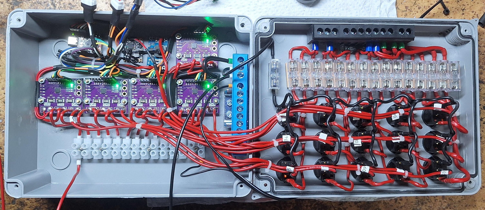
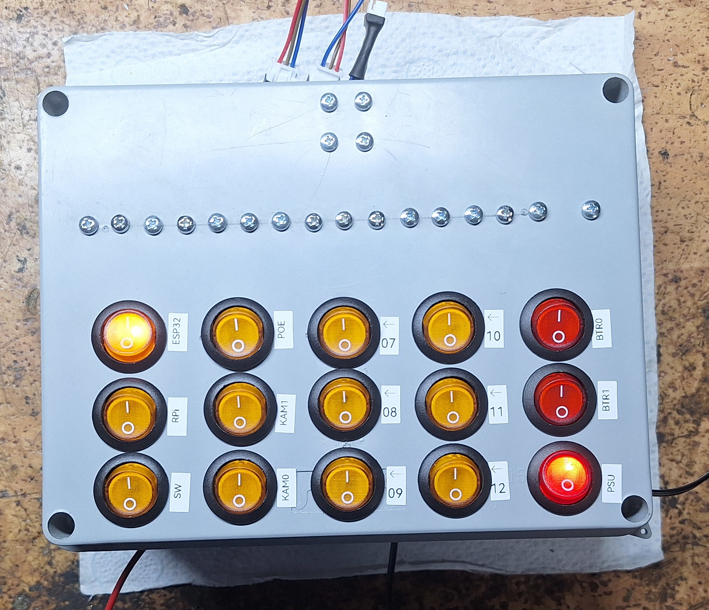
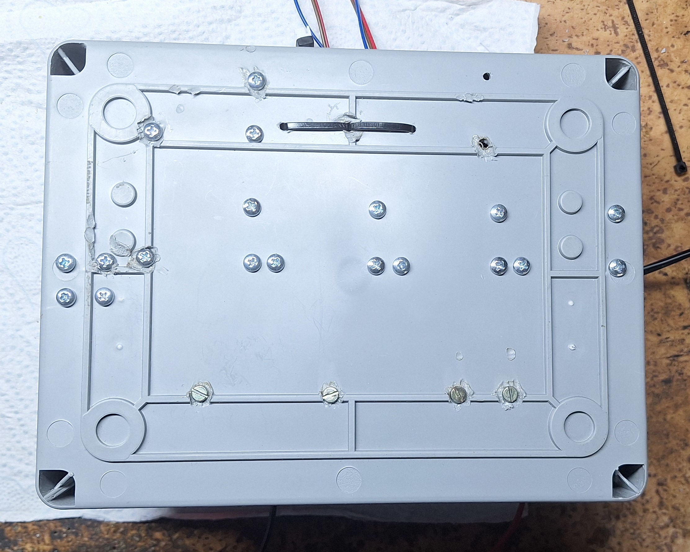

# PowerBox – Zigbee DC/AC power monitor (ESP32-C6)

A Zigbee **router** firmware for the ESP32-C6, plus a Zigbee2MQTT external converter, that turns a
12 V distribution box into a monitored one: per-channel voltage, current and power on 15 DC channels,
one mains (AC) meter, and two temperature/humidity sensors. It is meant as a worked example of a
non-trivial Zigbee device built on ESP-IDF and the `esp-zigbee-lib` 2.x API, and as the firmware of a real box.

| | |
|---|---|
| Model string | `PowerBox-DC15-AC1-DHT2` (Basic cluster `modelId`, must match the converter) |
| Target | ESP32-C6 SuperMini (4 MB flash) |
| Framework | PlatformIO + ESP-IDF 5.5.x, `esp-zigbee-lib` ^2.0.5 |
| Zigbee role | Router (mains powered) |
| Coordinator side | Zigbee2MQTT (external converter, ESM `.mjs`) |

## What it measures

- **15 DC channels** with 5 × INA3221 on two I²C buses (voltage, current, power per channel; the shunt of every
  channel is set in [`config.h`](src/config.h)).
- **AC mains** with a PZEM-004T v3 over UART (Modbus-RTU, 9600 8N1): voltage, current, active power, frequency,
  power factor, energy counter. The energy counter can be reset over Zigbee.
- **2 × DHT22** (temperature, humidity) and the on-chip board temperature.
- A **fault mask** that tells which unit (INA3221, DHT, PZEM, Zigbee) is not working, and an optional GPIO that
  goes high when anything is not OK.

Values of an unavailable sensor are published as `null` (not as a bogus number), and a failed module is retried
automatically.

## Zigbee endpoint map

| Endpoint | Content |
|---|---|
| 0x01 | board temperature, Basic, fault indication (Binary Input) and the fault mask (manufacturer cluster `0xFC11`) |
| 0x02, 0x03 | DHT #1, #2: temperature, humidity |
| 0x10–0x12, 0x13–0x15, 0x16–0x18, 0x19–0x1B, 0x20–0x22 | INA3221 #1 … #5, channels 1–3: DC voltage, current, power (Electrical Measurement, DC attributes) |
| 0x30 | PZEM-004T #1: Electrical Measurement (AC) + Metering (energy), and the control cluster `0xFC12` |

DC values are reported in mV / mA / 10 mW, AC in 0.1 V / 10 mA / W / 0.1 Hz, energy as Wh in the Metering
cluster (the converter publishes kWh). The firmware writes default reporting records on the first start so the
device already reports before the coordinator configures it; Zigbee2MQTT's *Configure/Reconfigure* overwrites
them with the converter's values (kept equal to the firmware defaults).

## Build and flash

1. Install [PlatformIO](https://platformio.org/) (VS Code extension or CLI).
2. Clone the repository and open the folder.
3. Build and upload (the Espressif component manager downloads `esp-zigbee-lib`, `dht` and `ina3221` on the first build):

   ```sh
   pio run -t upload
   pio device monitor        # 115200 baud
   ```

The first build creates `sdkconfig.<env>` from `sdkconfig.defaults`. After editing [`sdkconfig.defaults`](sdkconfig.defaults), delete
the generated file to apply the change. The firmware version string is the short git hash (suffix `-d` if the
working tree is dirty).

## Configuration

Everything that is hardware- or deployment-specific is in one file, [`src/config.h`](src/config.h): pins, I²C/UART buses, INA3221
address layout and shunt values, measurement intervals, reporting defaults and per-channel thresholds, task stacks,
log topics and the PZEM energy-reset mode.

PZEM energy reset (`Config.Sensor.Pzem.EnergyReset`):

| Value | Behaviour |
|---|---|
| `PZEM_ENERGY_RESET_IGNORE` | the request is dropped silently |
| `PZEM_ENERGY_RESET_LOG_ONLY` | the request is logged, nothing is sent to the module |
| `PZEM_ENERGY_RESET_EXECUTE` | the module's counter is reset (Modbus function `0x42`) |

## Pairing with Zigbee2MQTT

1. Copy [`powerbox_dc15_ac1_dht2.mjs`](powerbox_dc15_ac1_dht2.mjs) to `<zigbee2mqtt>/data/external_converters/` and restart Zigbee2MQTT.
2. Enable *permit join*, power the device. It starts joining automatically when it is not part of a network.
3. After the interview, run *Reconfigure* once if the reporting needs to be (re)written.
4. To make the device forget the network, hold the **BOOT button (GPIO9) for 3 s**; it clears the Zigbee
   data and restarts.

Energy reset from the frontend: choose `reset` in the *energy reset* control of the PZEM endpoint. It writes `1` to
the control cluster `0xFC12` (attribute `0x0000`); the firmware executes it and sets the attribute back to `0`.

For availability (online/offline) in Zigbee2MQTT enable `availability` in `configuration.yaml`; as a router the
device is pinged actively.

## Hardware

The reference box (15 switched, fused channels, shunt per channel, two separate DC/DC converters for the ESP32 and
the Raspberry Pi, a PZEM-004T for the mains input) is documented in [`hwdocs/`](hwdocs/):

| File | Content |
|---|---|
| [`layout/layout.md`](hwdocs/layout/layout.md) | physical layout, dimensions, mechanical notes (Hungarian) |
| [`pinout/pinout_pwr.txt`](hwdocs/pinout/pinout_pwr.txt), [`pinout/pinout_it.txt`](hwdocs/pinout/pinout_it.txt) | power wiring, signal wiring (I²C, UART, DHT, PZEM) |
| [`shunt_fuse.txt`](hwdocs/shunt_fuse.txt) | per-channel load, shunt and fuse table |
| [`layout/lid_layout.svg`](hwdocs/layout/lid_layout.svg), [`layout/lid_wiring.svg`](hwdocs/layout/lid_wiring.svg), [`layout/base_layout.svg`](hwdocs/layout/base_layout.svg), [`layout/base_wiring.svg`](hwdocs/layout/base_wiring.svg), [`layout/box_layout_A4.pdf`](hwdocs/layout/box_layout_A4.pdf) | layout and wiring drawings (lid, base; the PDF is the 1:1 A4 print) |

The hardware drawings and notes describe one specific build; adapt the channel table and shunts in [`config.h`](src/config.h) to
yours.

<p>
  <a href="hwdocs/photos/base_lid_internal.jpg"></a><br>
  <em>Base (left) and lid (right) from inside: INA3221 modules, ESP32, busbars, terminal block, fuses and switches.</em>
</p>

<p>
  <a href="hwdocs/photos/lid_external.jpg"></a>
  <a href="hwdocs/photos/base_external.jpg"></a><br>
  <em>Lid from outside (15 illuminated switches, fuse screws) and base from outside. Click for the full size.</em>
</p>

> **Safety.** The PZEM-004T is connected to the mains. Only work on a mains-connected setup if you are qualified to,
> keep the mains side isolated and enclosed, and never touch it while energized. The DC side is a low-voltage but
> high-current source: fuse every channel and do not exceed the INA3221 limits (26 V bus voltage, ±163.8 mV across
> the shunt).

## Repository layout

```
src/                       firmware (C++/C, ESP-IDF components in one folder)
cmake/git_version.cmake    firmware version from git
partitions.csv             partition table (4 MB flash)
sdkconfig.defaults         ESP-IDF configuration defaults
powerbox_dc15_ac1_dht2.mjs Zigbee2MQTT external converter
hwdocs/                    hardware documentation
```

## Status

Tested with Zigbee2MQTT and an EmberZNet-based coordinator (EmberZNet 7.4.5). Not a certified product.

## AI assistance

This project was developed with the help of an AI assistant, [Claude](https://www.anthropic.com/claude) by
Anthropic. Claude contributed to the firmware, the Zigbee2MQTT converter, the hardware documentation and this
README (design discussion, code and text drafts, reviews, analysis of test logs). The author specified the
requirements, reviewed the results, built and flashed the firmware, and ran all hardware tests and measurements.
The AI had no access to the hardware and did not compile the firmware itself. Responsibility for the content stays
with the author.

## License

[MIT](LICENSE) © 2026 Pánczél Bálint
